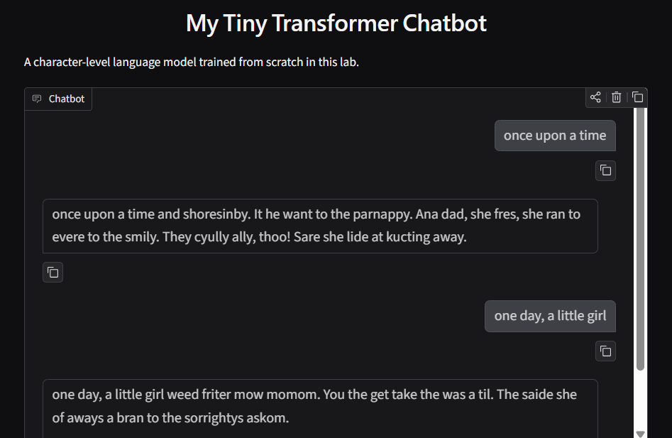

# Lab 03: Developing a Tiny Transformer Language Model

## Laboratory Session
Lab 03, Developing a Tiny Transformer Language Model (PUSL 3205)

## Objective
Build, train, evaluate, and save a small Transformer language model from scratch,
applying the attention mechanism (Query/Key/Value, scaled dot-product and multi-head
attention, positional encoding) covered in the lecture material.

## Tasks and Implementation
- Dataset: [TinyStories](https://huggingface.co/datasets/roneneldan/TinyStories), 1,000 stories (900 train / 100 validation)
- Tokenization: character-level, 75-character vocabulary, with encode/decode checked
- Model: a causal Transformer built from scratch — token + positional embeddings, masked
  multi-head self-attention, feed-forward layer, residual connections, LayerNorm (80,715 parameters)
- Training: AdamW optimizer, cross-entropy loss, 15 epochs
- Evaluation: validation loss, perplexity, and sample story generation
- Extension: trained a smaller variant (1 layer, 1 head) and compared it to the baseline (2 layers, 2 heads)
- Notebook: [notebooks/lab3_tiny_transformer.ipynb](notebooks/lab3_tiny_transformer.ipynb)
- Optional: a Gradio chat interface for the trained model, in its own notebook: [notebooks/lab3_gradio_chat.ipynb](notebooks/lab3_gradio_chat.ipynb)
- Background notes: [notes.md](notes.md)

## Architecture Mapping
How the `TinyTransformer` class (and the required Task 4 components) map onto the `print(model)`
output in [05-model-architecture.png](results/05-model-architecture.png):

| Required component | Class/variable in the notebook |
|---|---|
| Token embeddings | `self.token_emb` (`nn.Embedding(vocab_size, embed_dim)`) |
| Positional embeddings | `self.pos_emb` (`nn.Embedding(block_size, embed_dim)`) |
| Masked multi-head self-attention | `self_attn` inside each `TransformerEncoderLayer`, made causal via the `mask` passed into `self.blocks(x, mask=mask)` in `forward()` |
| Feed-forward layers | `linear1` → GELU → `linear2` inside each `TransformerEncoderLayer` |
| Residual connections | built into `nn.TransformerEncoderLayer`'s `forward()` (not a separate named layer) — each sub-layer's output is added back to its input |
| Layer norm | `norm1` and `norm2` inside each `TransformerEncoderLayer` |

## Hyperparameters
Values as set in the notebook (cells 8, 6, and 10):

| Hyperparameter | Value |
|---|---|
| Embedding size | 64 |
| Layers | 2 |
| Heads | 2 |
| Block size | 64 |
| Batch size | 32 |
| Learning rate | 1e-3 |
| Optimizer | AdamW |
| Loss function | Cross-entropy (over next-character predictions) |

## Results and Evidence
- Validation loss dropped from 4.46 to 1.56 over 15 epochs; final perplexity: 4.77.
- Smaller model (1 layer, 1 head) scored worse (loss 1.768) and produced less coherent text than
  the baseline (loss 1.563), trained for the same number of steps.
- Full loss curves, generated stories, and the capacity comparison are in the notebook's output.
- The Gradio chat interface was actually launched and tested with a real message through the
  running server (not just the underlying function) — see its notebook's output.
- Screenshots: see [results/](results/) for the full set; a live chat exchange with the model:

  

## Observations
- Building the Transformer from scratch made the pipeline (tokenizer → Transformer blocks → output)
  feel real instead of just a diagram — seeing the loss fall gave an actual number to "the model is
  learning".
- Perplexity only makes sense with context: 4.77 is good here because it's character-level and the
  "random guessing" baseline for this vocabulary is much higher — it isn't comparable to
  word-level perplexity scores from real LLMs.
- Fewer layers/heads clearly hurt performance under the same training budget — a direct,
  measurable example of why model capacity matters.

Full reflection: [reflection.md](reflection.md).

## Learning Outcomes
- Implemented masked multi-head self-attention, positional encoding, and a feed-forward block from scratch.
- Ran a full training loop and learned to read loss curves and perplexity as real evidence of learning.
- Saw directly how model capacity (layers/heads) affects both the loss number and the quality of generated text.
- Connected the "Attention Is All You Need" theory to an actual working implementation.
