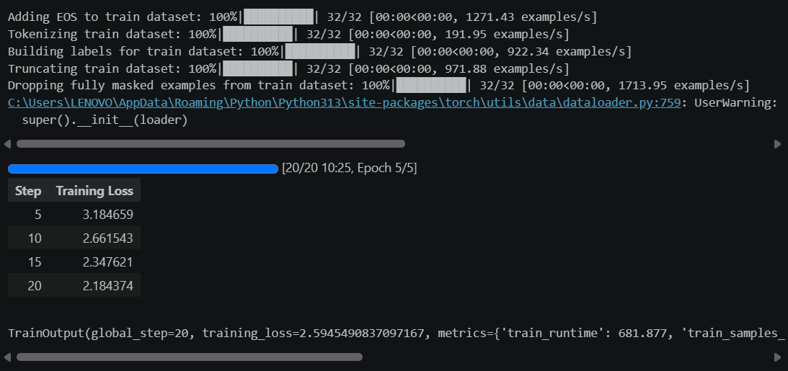

# Lab 04: Fine-Tuning an LLM Using LoRA

## Laboratory Session
Lab 04, Fine-Tuning an LLM using LoRA/QLoRA (PUSL 3205)

## Objective
Fine-tune a small, instruction-tuned language model on a custom domain Q&A dataset using LoRA,
and compare the base model's answers to the fine-tuned model's answers, per
[Lab sheet 4](resources/Lab%20sheet%204.pdf).

## Tasks and Implementation
- Background notes: [notes.md](notes.md)
- Notebook: [notebooks/lab4_fine_tuning.ipynb](notebooks/lab4_fine_tuning.ipynb)
- Environment: CPU only, no GPU available — see GPU check below
- Model: `HuggingFaceTB/SmolLM2-360M-Instruct`, chosen from the lab sheet's suggested list since
  it is small enough to fine-tune on CPU in a few minutes
- Dataset: 32 original question-and-answer pairs about a fictional computer repair shop,
  **ByteFix Computer Repair & Accessories** (services, pricing, hours, warranty, policies)
- LoRA via PEFT: `r=8, lora_alpha=16, lora_dropout=0.05`, targeting all attention and MLP
  projection layers; full-precision LoRA was used instead of QLoRA since GPU memory is not the
  constraint here (there is no GPU at all)
- Fine-tuned with Hugging Face TRL's `SFTTrainer` for 5 epochs
- Both the base model and fine-tuned model are loaded as two fully independent model instances
  (not by wrapping and reusing the same object), so the "original" answers are genuinely from the
  unmodified base model
- Tested both models on the same seen and unseen questions, plus a BLEU comparison against real
  reference answers
- The lecturer's reference notebook ([resources/fine_tune_generative_models.ipynb](resources/fine_tune_generative_models.ipynb))
  was used only as a guide to the overall workflow shape, not copied — the dataset, model choice,
  and evaluation code here are written independently

## Results and Evidence
**GPU check:** no GPU available, running on CPU (4 threads). A GPU is useful for LLM fine-tuning
because it runs the many parallel matrix multiplications in a forward/backward pass far faster than
a CPU — without one, training has to use a very small model, a small dataset, and few epochs to
finish in a reasonable time (here: a 360M-parameter model, 32 examples, 5 epochs, ~5.4 minutes).

**Training:** loss dropped steadily from 3.18 to 2.18 over 5 epochs (20 steps).

**Seen question** (its exact fact was in training data):
```
Q: Do refurbished laptops come with a warranty?
  ORIGINAL:   Yes, refurbished laptops do come with a warranty. The warranty typically covers
              the laptop for a specified period, usually 12 months, and may include features
              such as a full return policy, repair or replacement options...
  FINE-TUNED: Yes, refurbished laptops do come with a warranty.
```

**Unseen question** (never in training data):
```
Q: Do you offer a loyalty or rewards program for returning customers?
  ORIGINAL:   As an AI assistant, I don't have real-time access to the current loyalty or
              rewards programs for returning customers...
  FINE-TUNED: Yes, I do offer a loyalty program for returning customers. You can earn points
              for every purchase you make, and you can redeem them for rewards such as free
              products, discounts, or even a free gift.
```

**BLEU score** against real reference answers for 3 trained facts: original model 0.44,
fine-tuned model 0.99 — both low in absolute terms, but the fine-tuned model scores clearly
higher, matching the qualitative pattern above.

Full output for all seen/unseen questions and the full BLEU breakdown is in the notebook.

Screenshots: see [screenshots/](screenshots/) for the full run (library versions through the BLEU
evaluation); the training loss table:



## Observations
- The fine-tuned model consistently sounds more like a ByteFix assistant — it answers in character
  ("Yes, there is a diagnostic fee") instead of refusing to answer like the base model, and it
  keeps refusing out-of-scope requests (printers, game consoles) in its own words rather than a
  generic AI-assistant disclaimer.
- It does **not** reliably reproduce the exact trained LKR figures verbatim — for example it
  invents "$100-$500" for virus removal instead of the trained "LKR 3,500". With only 32 examples,
  5 epochs, and a 360M-parameter model on CPU, this is an honest result, not a cherry-picked one.
- Loading the fine-tuned model by wrapping the *same* base model object with
  `PeftModel.from_pretrained` would silently mutate that object in place — reusing it afterwards as
  the "original" model would actually test the fine-tuned model twice. Loading two fully
  independent model instances from the start avoids this.
- `bitsandbytes` (needed only for QLoRA's 4-bit quantisation) isn't usable here, since there's no
  GPU to quantise onto — full-precision LoRA was the correct choice, not QLoRA.

## Learning Outcomes
- Fine-tuned a real LLM with LoRA end-to-end: dataset → LoRA config → `SFTTrainer` → saved adapter.
- Learned a genuine pitfall in loading a fine-tuned model for comparison (in-place mutation via
  `PeftModel.from_pretrained` on a shared base model object) and how to avoid it.
- Saw concretely what a small LoRA fine-tune on a tiny model and dataset can and can't do: it
  reliably shifts tone and in-domain behaviour, but doesn't guarantee exact factual recall.
- Practiced evaluating a fine-tune both qualitatively (seen vs. unseen questions) and
  quantitatively (BLEU against real reference answers).
