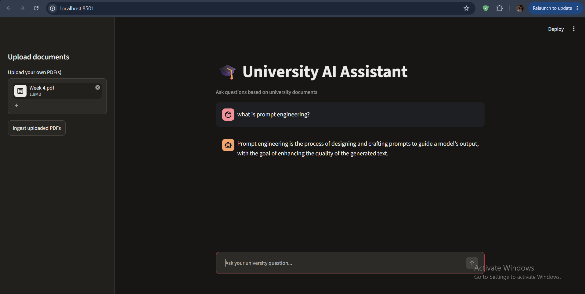

# Lab 05: RAG Architecture (Retrieval-Augmented Generation)

## Laboratory Session
Lab 05, RAG Architecture (Retrieval-Augmented Generation) (PUSL 3205)

## Objective
Set up a local RAG stack (Python, LangChain, Ollama, ChromaDB), build an ingestion script and a
retrieval/generation pipeline, and extend it into an app that can read multiple PDFs, including
ones the user uploads.

## Tasks and Implementation
- Background notes: [notes.md](notes.md)
- Setup: Python 3.12 virtual environment with LangChain, ChromaDB, Streamlit, and PyMuPDF
- Models: `llama3.2:3b` (LLM) and `qwen3-embedding:0.6b` (embeddings), both run locally via Ollama
- [app/rag_core.py](app/rag_core.py): shared logic — PDF loading/chunking, embeddings, vector
  store, and the retrieve → prompt → generate chain, reused by both apps below
- [app/ingest.py](app/ingest.py): loads every PDF in a folder (supports multiple PDFs at once),
  chunks and embeds them, and saves them into a ChromaDB store
- [app/rag_pipeline.py](app/rag_pipeline.py): a terminal Q&A loop that answers questions grounded
  only in the retrieved content (told to say "I don't know" rather than guess)
- [app/streamlit_app.py](app/streamlit_app.py): a chat UI with a PDF uploader, so users can add
  their own documents at any time and query them immediately
- Tested by ingesting two of this portfolio's own lecture PDFs (Week 5 and Week 6) as sample
  "university documents" — 43 chunks total, then adding a third (Week 4) later through the
  Streamlit uploader
- To run locally: create the venv, install `app/requirements.txt`, put PDFs in `app/data/`, run
  `python ingest.py`, then `python rag_pipeline.py` or `streamlit run streamlit_app.py`

## Results and Evidence
Real, grounded answers from `rag_pipeline.py` after ingesting Week 5 and Week 6:
```
Ask a university question (or exit): what are the main topics covered?

Answer: I don't know the main topics covered.

Ask a university question (or exit): what is 'parse' in indexing?

Answer: In the context of Indexing, "Parse" refers to the step of Extracting raw text
from documents, such as PDFs or web pages.
```
The first question was too broad for the retriever to match to specific chunks, and the model
correctly said it didn't know rather than guessing; the second question got a precise, grounded
answer.

The Streamlit app was tested interactively: uploaded `Week 4.pdf` (not part of the original
ingestion) through the sidebar, ingested it live, and asked "what is prompt engineering?" — the
app answered correctly from the newly uploaded PDF alone.

Screenshots: see [screenshots/](screenshots/) for the full run — environment setup through the
Streamlit upload and grounded answer:



| # | File | What it shows |
|---|------|----------------|
| 1 | [01-environment-setup.png](screenshots/01-environment-setup.png) | venv + `pip install -r requirements.txt` |
| 2 | [02-chromadb-check.png](screenshots/02-chromadb-check.png) | ChromaDB import check |
| 3 | [03-requirements.png](screenshots/03-requirements.png) | `requirements.txt` |
| 4 | [04-ollama-models.png](screenshots/04-ollama-models.png) | `ollama list` — both models pulled |
| 5 | [05-ollama-service.png](screenshots/05-ollama-service.png) | Ollama running at `localhost:11434` |
| 6 | [06-project-structure.png](screenshots/06-project-structure.png) | Folder tree with PDFs in `app/data/` |
| 7 | [07-ingestion.png](screenshots/07-ingestion.png) | `ingest.py` — PDFs found, chunks created |
| 8 | [08-cli-question-1.png](screenshots/08-cli-question-1.png) | `rag_pipeline.py` — first CLI question |
| 9 | [09-cli-question-2.png](screenshots/09-cli-question-2.png) | `rag_pipeline.py` — second CLI question |
| 10 | [10-streamlit-home.png](screenshots/10-streamlit-home.png) | Streamlit UI on first load |
| 11 | [11-streamlit-upload.png](screenshots/11-streamlit-upload.png) | Uploading and ingesting a new PDF |
| 12 | [12-answer-from-uploaded-pdf.png](screenshots/12-answer-from-uploaded-pdf.png) | Correct answer from the uploaded PDF |


## Observations
- When asked something barely covered by the ingested PDFs, the model partly followed the "say
  you don't know" instruction but phrased it a little inconsistently — grounding instructions help
  but don't fully fix a small 3B model's odd behaviour.
- Keeping the shared logic in `rag_core.py` meant the Streamlit upload feature reuses the exact
  same functions as the command-line ingestion script, with no duplicated code.
- Dropped the `sentence-transformers` dependency after it hit a Windows path-length error — not
  needed anyway, since embeddings go through Ollama directly.

## Learning Outcomes
- Set up a fully local RAG stack: Ollama for the LLM and embeddings, ChromaDB for storage, LangChain to connect them.
- Learned the full RAG pipeline end-to-end (load → chunk → embed → store → retrieve → generate) as working code, not just a diagram.
- Extended a single-document RAG app into one supporting multiple PDFs and live uploads, without duplicating logic.
- Saw that grounding prompts reduce, but don't fully eliminate, ungrounded answers from a small local model.
